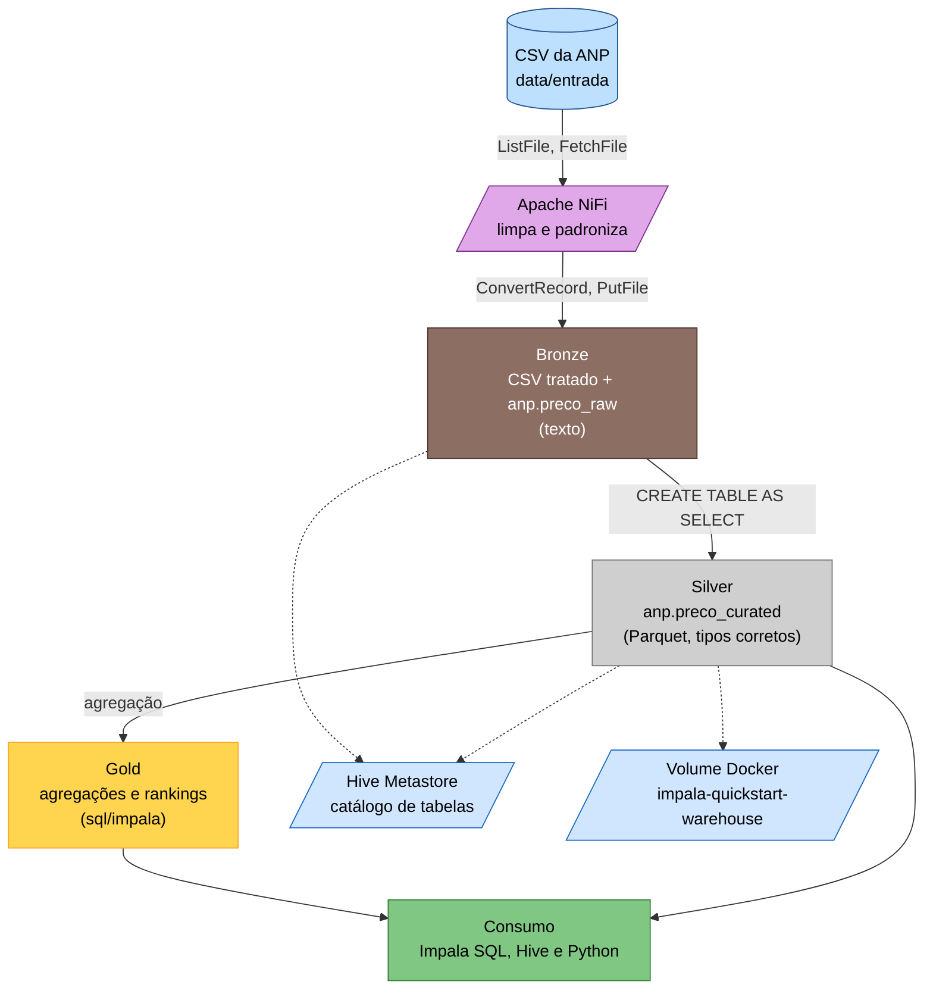
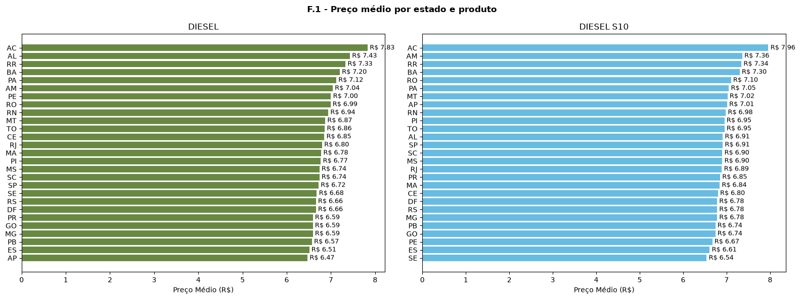
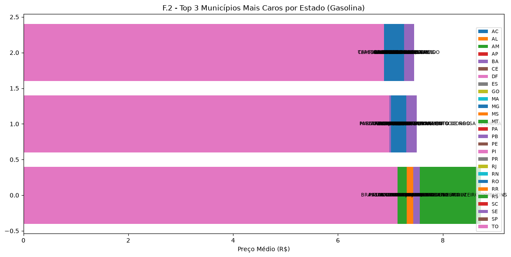
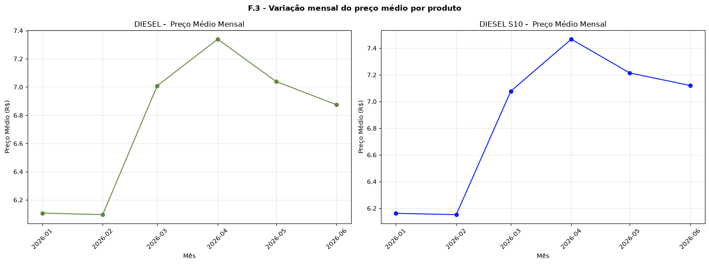

# Pipeline ANP: NiFi → Impala → Hive

Pipeline de estudo com dados abertos da ANP (preços de combustíveis, 1º semestre de 2026, ~422 mil linhas).

O NiFi limpa e padroniza o CSV, o Impala consulta em SQL (camadas raw e curated em Parquet), 
o Hive lê o mesmo metastore e o Python gera gráficos a partir das consultas.
Tudo roda em containers Docker no WSL.


## O que o projeto faz

- Lê o CSV original da ANP (`data/entrada/`) e aplica um schema com nomes de colunas limpos (NiFi).
- Grava o CSV tratado em `data/saida/precos_2026_01.csv`, com delimitador `|`.
- Expõe o arquivo como tabela externa `anp.preco_raw` (tudo texto) no Impala.
- Cria a camada `anp.preco_curated` em **Parquet**, com tipos corretos (data, `DECIMAL`) e textos padronizados.
- Roda consultas analíticas com window functions (`sql/impala/`).
- Disponibiliza o HiveServer2 no mesmo Hive Metastore.
- Gera gráficos em Python (`impyla` + pandas + matplotlib) a partir das consultas, salvos em `docs/graficos/`.

## Stack

| Camada             | Tecnologia                                   |
|--------------------|----------------------------------------------|
| Containers         | Docker e Docker Compose (WSL/Ubuntu)         |
| Ingestão e limpeza | Apache NiFi 2.x                              |
| Consulta SQL       | Apache Impala (quickstart oficial, ajustado) |
| Catálogo           | Hive Metastore                               |
| SQL via Hive       | HiveServer2 (`apache/hive:3.1.3`)            |
| Formato analítico  | Parquet                                      |
| Análise e gráficos | Python 3.12, `impyla`, pandas, matplotlib    |
| Dependências       | Poetry (`pyproject.toml`, `poetry.lock`)     |
| Versionamento      | Git e GitHub                                 |

## Arquitetura

O projeto segue a **Arquitetura Medallion** (Bronze → Silver → Gold), com ingestão no NiFi e processamento ELT no Impala:



| Camada     | Onde                            | Conteúdo                                                                   | Formato                       |
|------------|---------------------------------|----------------------------------------------------------------------------|-------------------------------|
| **Bronze** | `data/saida/` e `anp.preco_raw` | Dados da ANP sem transformar de tipo (tudo texto), nomes de colunas limpos | CSV com `\|` / tabela externa |
| **Silver** | `anp.preco_curated`             | Data como `TIMESTAMP`, preço como `DECIMAL(10,2)`, textos padronizados     | Parquet                       |
| **Gold**   | `sql/impala/`                   | Preço médio por produto/estado, ranking de municípios, variação mensal     | Consultas SQL                 |

### Serviços

| Serviço               | Container                                    | Porta(s)                  |
|-----------------------|----------------------------------------------|---------------------------|
| NiFi                  | `nifi`                                       | `8443`                    |
| Impala (coord + exec) | `impala-impalad-1-1`                         | `21000`, `21050`, `25000` |
| Catalog / Statestore  | `impala-catalogd-1` / `impala-statestored-1` | `25020` / `25010`         |
| Hive Metastore        | `quickstart-hive-metastore`                  | interna                   |
| HiveServer2           | `quickstart-hiveserver2`                     | `10000`, `10002`          |

O NiFi e o Impala não devem rodar juntos: no meu caso o PC tem ~7,4 GB de RAM (WSL com ~5 GB).
Se o seu caso for o mesmo, ligue o NiFi, gere o arquivo, desligue-o e use o Impala.

### Fluxo do NiFi (grupo `ingestao_combustiveis`)

| Processador         | O que faz                                                                                                 |
|---------------------|-----------------------------------------------------------------------------------------------------------|
| **ListFile**        | Lista os CSVs em `/data/entrada` (guarda estado para não repetir arquivos)                                |
| **FetchFile**       | Lê o conteúdo do arquivo listado                                                                          |
| **ConvertRecord**   | CSVReader (schema com nomes limpos, separador `;`) e CSVRecordSetWriter (sem cabeçalho, delimitador `\|`) |
| **UpdateAttribute** | Define `filename = precos_2026_01.csv` (nome sem acento)                                                  |
| **PutFile**         | Grava em `/data/saida`                                                                                    |

## Estrutura de diretórios

```
combustivel-anp/
├── docker-compose.yml          # sobe o NiFi
├── impala/
│   ├── quickstart.yml          # Impala (repositório oficial, ajustado)
│   └── quickstart_conf/
├── sql/
│   ├── hive/                   # HiveServer2 (hs2.yml) e SQL do Hive
│   └── impala/                 # consultas F.1, F.2 e F.3
├── python/
│   ├── main.py                 # orquestra as consultas e os gráficos
│   ├── db.py                   # conexão com o Impala e leitura dos .sql
│   ├── graficos.py             # gráficos (matplotlib)
│   └── config.py               # constantes (host, porta, folder)
├── docs/
│   └── graficos/               # PNGs gerados pelo Python
├── pyproject.toml / poetry.lock
├── .env                        # credenciais (fora do Git)
├── .env.example                # modelo das credenciais
└── data/                       # fora do Git
    ├── entrada/                # CSV original da ANP
    ├── saida/                  # CSV tratado pelo NiFi (só ele; é a LOCATION da tabela)
    └── backup/
```

Ajustes no `impala/quickstart.yml`: `mem_limit` de 4 GB para 2 GB;
`../data/saida` montada em `/data/saida` no `hms`, `catalogd` e `impalad-1`;
volume `impala-quickstart-warehouse` também montado no `impalad-1`.

## Como executar

Pré-requisitos: Docker e Docker Compose no WSL (Ubuntu), Poetry e Python 3.12.

```bash
git clone https://github.com/flrmedeiros78/combustivel-anp.git
cd combustivel-anp
cp .env.example .env     # defina NIFI_PASSWORD (12+ caracteres)
poetry install
sudo service docker start
```

**Subir o Impala**

```bash
export QUICKSTART_LISTEN_ADDR=127.0.0.1
export IMPALA_QUICKSTART_IMAGE_PREFIX="apache/impala:81d5377c2-"
docker compose -f impala/quickstart.yml up -d
docker run -it --rm --network=quickstart-network ${IMPALA_QUICKSTART_IMAGE_PREFIX}impala_quickstart_client impala-shell -i impala-impalad-1-1:21050
```

Se der erro de rede: `docker network create -d bridge quickstart-network`.

**Subir o Hive e o NiFi (só quando precisar)**

```bash
docker compose -f sql/hive/hs2.yml up -d     # depois do Impala
docker compose up -d nifi                    # https://localhost:8443/nifi
```

**Gerar o CSV tratado:**
no grupo `ingestao_combustiveis`, ListFile → View state → Clear state, depois Play.
Confira com `wc -l data/saida/precos_2026_01.csv` (esperado: 422418). Pare o fluxo e o NiFi: `docker compose stop nifi`.

**Gerar os gráficos** (com o Impala no ar):

```bash
cd python
poetry run python main.py
```

Os PNGs são salvos em `docs/graficos/`.

**Desligar:**
`docker compose stop nifi`,
`docker compose -f sql/hive/hs2.yml stop`,
`docker compose -f impala/quickstart.yml stop`.
Evite `docker compose down -v`: ele apaga as tabelas do Impala e o fluxo do NiFi.

## Modelo de dados

```sql
CREATE EXTERNAL TABLE anp.preco_raw (
   regiao_sigla STRING
  ,estado_sigla STRING
  ,municipio STRING
  ,revenda STRING
  ,cnpj_revenda STRING
  ,nome_rua STRING
  ,numero_rua STRING
  ,complemento STRING
  ,bairro STRING
  ,cep STRING
  ,produto STRING
  ,data_coleta STRING
  ,valor_venda STRING
  ,valor_compra STRING
  ,unidade_medida STRING
  ,bandeira STRING
  )
ROW FORMAT DELIMITED FIELDS TERMINATED BY '|'
STORED AS TEXTFILE LOCATION '/data/saida';
```

A `anp.preco_curated` (Parquet) converte `data_coleta` para `TIMESTAMP`,
`valor_venda` para `DECIMAL(10,2)` (`vlr_venda`) e padroniza os textos com `trim(UPPER(...))`.

## Consultas analíticas

Em [`sql/impala/`](sql/impala/): preço médio por produto e estado (`f1_preco_medio_estado.sql`), top 3 municípios mais caros por estado com `RANK` (`f2_top3_municipios_caros.sql`) e variação mensal do preço médio com `LAG` (`f3_variacao_mensal_preco.sql`).

Resultados em destaque: o diesel subiu cerca de 15% em março de 2026 e depois recuou; o etanol caiu em maio e junho.

## Gráficos

Gerados por `python/main.py` a partir das consultas acima:





## Habilidades praticadas

- Containers com Docker Compose, redes e volumes compartilhados entre serviços
- Ingestão e limpeza de dados com NiFi (Record processors, estado, atributos)
- Modelagem raw → curated (ELT) com Parquet no Impala
- SQL analítico: window functions (`RANK`, `LAG`), CTEs e agregações
- Hive Metastore compartilhado entre Impala e Hive
- Python com Poetry, `impyla`, pandas e matplotlib
- Git e GitHub

## Desafios resolvidos durante o desenvolvimento

| Problema                                             | Causa                                                  | Solução                                                              |
|------------------------------------------------------|--------------------------------------------------------|----------------------------------------------------------------------|
| `Cannot connect to the Docker daemon`                | WSL sem systemd                                        | `sudo service docker start`                                          |
| Containers morriam/travavam                          | WSL limitado a ~3,6 GB                                 | `.wslconfig` com `memory=5GB` e `swap=4GB`, depois `wsl --shutdown`  |
| Colunas vazias no CSV de saída                       | Cabeçalho do CSV diferente do schema                   | Schema Text + `Ignore CSV Header Column Names = true`                |
| GetFile relia o arquivo em loop                      | Sem estado com `Keep Source File = true`               | ListFile + FetchFile                                                 |
| `ParquetRecordSetWriter` ausente                     | Módulo Parquet não vem na imagem 2.x                   | NiFi gera CSV; Parquet é criado no Impala (ELT)                      |
| Impala retornava 0 linhas                            | `ç` no nome do arquivo                                 | `UpdateAttribute` com `filename` sem acento                          |
| Colunas deslocadas, `String to Decimal parse failed` | `;` dentro de `complemento`                            | Delimitador `\|` no NiFi e na raw                                    |
| `Mkdirs failed to create .../preco_curated`          | `impalad-1` sem o volume do warehouse                  | Montar o volume no `impalad-1` e liberar permissão                   |
| `Invalid parquet fallback schema resolution`         | Variável de sessão inválida                            | `SET PARQUET_FALLBACK_SCHEMA_RESOLUTION=POSITION;`                   |
| Login do NiFi recusado após trocar a senha           | Container não recriado                                 | `docker compose up -d --force-recreate nifi`                         |
| Hive retornava `COUNT = 0`                           | Usava estatísticas do `COMPUTE STATS` do Impala        | `SET hive.compute.query.using.stats=false;`                          |
| Hive via `/data/saida` vazia                         | Volume relativo é contado a partir do yml (`sql/hive`) | Usar `../../data/saida` e recriar com `--force-recreate`             |
| `Connection refused` no Beeline logo após subir      | O HiveServer2 leva 1 a 2 min para abrir a porta        | Aguardar e conferir `docker logs quickstart-hiveserver2`             |
| Gráficos dentro de `data/saida`                      | A folder é a `LOCATION` da tabela raw                   | Salvar os PNGs em `docs/graficos/`                                   |

## Próximos passos

- [x] NiFi com `UpdateAttribute` (nome do arquivo sem acento)
- [x] Camada curated em Parquet
- [x] Consultas analíticas com window functions
- [x] HiveServer2 no mesmo metastore
- [x] Ambiente Python com Poetry e `impyla`
- [x] Testar a leitura da `anp.preco_curated` (Parquet) pelo Hive
- [x] Gráficos em Python (`main.py`)
- [x] Criar `.env.example`
- [ ] Documentar decisões e aprendizados em `docs/`
- [ ] Materializar a camada Gold em tabelas `anp.gold_*` (CTAS a partir de `sql/impala/`)

## Créditos

Projeto de estudo com dados abertos da ANP.
Desenvolvido como parte do aprendizado contínuo e práticas modernas de Engenharia de Dados/Análise de dados.

# Contato

- Fabio Medeiros
- Engenharia de Dados/Análise de dados
- Email: fabiolrm78@gmail.com
- Telefone: (21) 99663-7177
